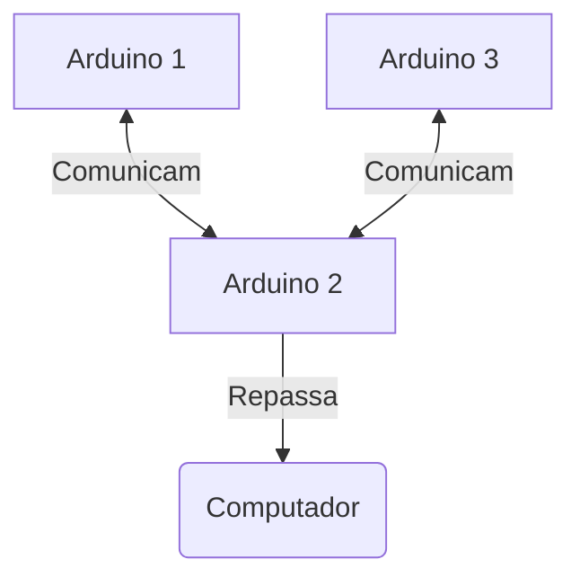
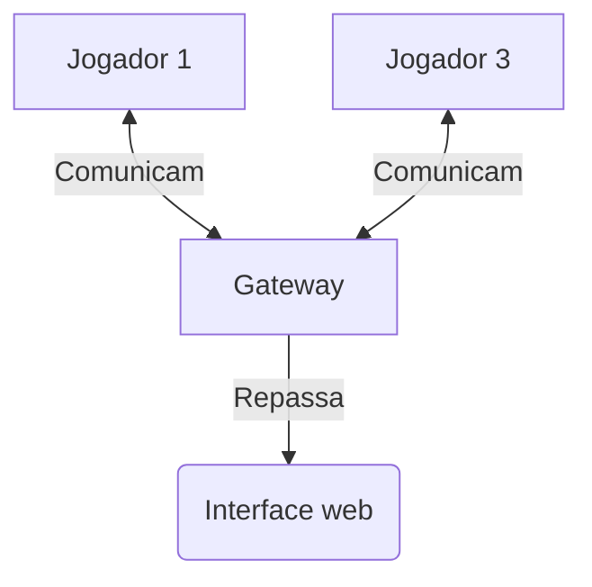

# Tópicos Especiais em Interfaces Computacionais
## Resumo do projeto
Consiste em estabelecer uma comunicação entre 3 *arduinos*, usando a seguinte topologia:


## Nosso trabalho
Seguindo essa estrutura como base, pensamos em fazer um jogo da velha. Seu desenho consiste em:


## Como executar
### Monitor serial
Vá para a pasta `cd ./src/backend/serial` Crie um ambiente virtual do python com: 
```python
python -m venv .venv
```

Depois, na root do projeto instale as dependências usando:
```makefile
make run install
```

Por fim, execute o monitor usando:
```makefile
make run
```

## Referências
Monitor de porta serial - [https://rahulsreedharan.medium.com/serial-port-programming-on-linux-using-python-and-pyserial-54f052f9f714](https://rahulsreedharan.medium.com/serial-port-programming-on-linux-using-python-and-pyserial-54f052f9f714)