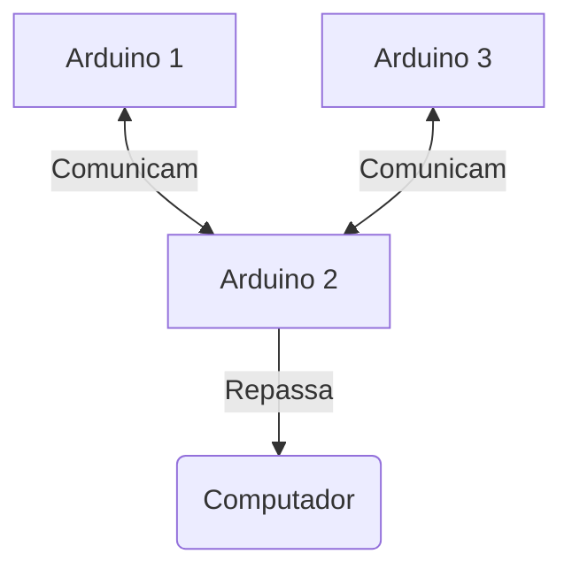
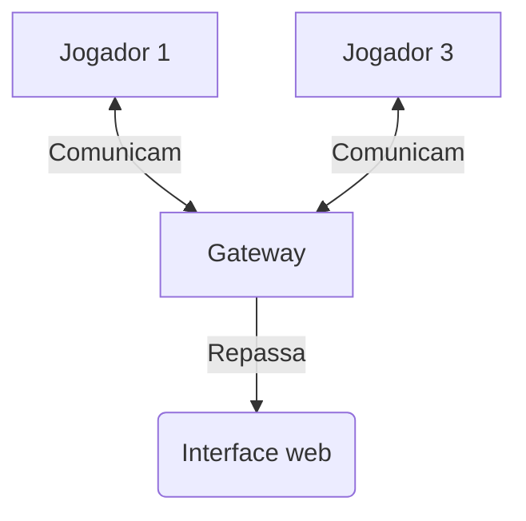

# Tópicos Especiais em Interfaces Computacionais

## Resumo do projeto

Consiste em estabelecer uma comunicação entre 3 _arduinos_, usando a seguinte topologia:



## Nosso trabalho

Seguindo essa estrutura como base, pensamos em fazer um jogo da velha. Seu desenho consiste em:



## Como executar

### Monitor serial

Vá para a pasta `cd ./src/backend/serial` Crie um ambiente virtual do python com:

```python
python -m venv .venv
```

Depois, na root do projeto instale as dependências usando:

```makefile
make run install
```

Por fim, execute o monitor usando:

```makefile
make run
```

## Uso de IA

Durante o projeto, houve o uso de LLMs para o desenvolvimento de alguns trechos de código. Especificamente:

1. Expressão regular no arquivo `src/backend/serial/ttt_parser.py`
2. Método `_sendSerial()` no `src/backend/gateway.ino/gateway.ino.ino`
3. Base da página html `src/frontend/index.html` e estilização `src/frontend/style.css`
4. Explicado como utilizar o Flask e criar suas rotas no `src/backend/api/api.py` e script no `src/frontend/index.html`

## Referências

Monitor de porta serial - [https://rahulsreedharan.medium.com/serial-port-programming-on-linux-using-python-and-pyserial-54f052f9f714](https://rahulsreedharan.medium.com/serial-port-programming-on-linux-using-python-and-pyserial-54f052f9f714)
